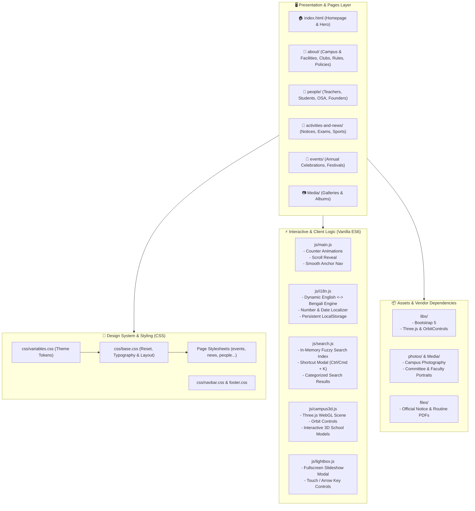

# 🏫 Kapotaksha High School (KHS) — Web Portal & Digital Campus

[](#automated-validation)
[](#tech-stack)
[](#bilingual-engine)
[](package.json)

Welcome to the official web architecture repository for **Kapotaksha High School (KHS)**, Padmapukur, Koyra, Khulna. This project provides a comprehensive digital portal featuring school governance records, academic notices, event archives, student & alumni directories, a bilingual localization engine (English/Bangla), an instant search engine, and an interactive 3D WebGL digital campus.

This codebase is specifically engineered so that **any developer can clone, understand, and develop features instantly without complex build steps or environment configuration.**

---

## 📑 Table of Contents
1. [System Architecture Diagram](#-system-architecture-diagram)
2. [Instant Developer Quickstart (Zero-Friction)](#-instant-developer-quickstart)
3. [Refined Directory Map](#-refined-directory-map)
4. [Core Architectural Systems](#-core-architectural-systems)
   - [Design Tokens & Styling System](#1-design-tokens--styling-system)
   - [Bilingual Engine (`i18n.js`)](#2-bilingual-engine-i18njs)
   - [Client-Side Search Index (`search.js`)](#3-client-side-search-index-searchjs)
   - [Interactive 3D WebGL Campus (`campus3d.js`)](#4-interactive-3d-webgl-campus-campus3djs)
   - [Media & Photo Lightbox (`lightbox.js`)](#5-media--photo-lightbox-lightboxjs)
5. [Developer Starter Templates](#-developer-starter-templates)
6. [Tooling & Quality Assurance](#-tooling--quality-assurance)

---

## 🏛 System Architecture Diagram



---

## 🚀 Instant Developer Quickstart

Zero setup required. You can choose either the live server or direct browser workflow:

### Option A: Local Live Server (Recommended)
Requires [Node.js](https://nodejs.org/):
```bash
# 1. Clone or open the repository folder in your terminal
cd School

# 2. Launch the instant live-reload dev server on http://localhost:3000
npm run dev
```

### Option B: Zero-Install Direct Preview
No Node.js or tools needed. Simply double-click `index.html` in your file explorer to view the site directly in Chrome, Firefox, Edge, or Safari.

---

## 🗂 Refined Directory Map

Every folder has a designated single responsibility. Refer to this table to know where files belong:

| Directory / File | Description & Usage Rules |
| :--- | :--- |
| `index.html` | The primary portal homepage containing Hero, Leadership messages, Quick Stats, 3D Campus, and Admissions modal. |
| `about/` | About Section Hub: `clubs.html`, `facilities.html`, `RulesRegulation.html`, and `IntimidationPolicy.html`. |
| `activities-and-news/` | School notice board, academic circulars, exam notices, and event reports. |
| `events/` | Dedicated landing pages for annual cultural programs (Durga Puja, Holi, Saraswati Puja, Orientations). |
| `Media/` | Media center and photo galleries (`Gallery.html` and `events/` photo albums). |
| `people/` | Directories for `teachers.html`, `students.html`, `adviser.html`, `Founders.html`, and `OSA.html`. |
| `css/` | All central stylesheets. Subdivided into global design tokens (`variables.css`), core layout (`base.css`), and modular styles. |
| `js/` | All modular client JavaScript: `main.js`, `i18n.js`, `search.js`, `campus3d.js`, and `lightbox.js`. |
| `photos/` | High-resolution photography, logos (`KHS.png`), cover banners (`Cover.gif`), and faculty portraits. |
| `files/` | Downloadable circulars, timetables, routines, and official PDF documents. |
| `libs/` | Offline vendor libraries: Bootstrap 5 bundle and Three.js 3D engine. |
| `templates/` | Ready-to-copy boilerplate templates for adding new pages, events, and notices instantly. |
| `scripts/` | Developer CLI automation (e.g. `check-links.js`). |

---

## 🧠 Core Architectural Systems

### 1. Design Tokens & Styling System
Global styling is centralized in [`css/variables.css`](file:///c:/Users/Krishanu/OneDrive%20-%20American%20International%20University-Bangladesh/School/css/variables.css). Always use CSS variables instead of hardcoded hex values:
- `--khs-primary`: Deep Oxford Navy (`#002147`)
- `--khs-accent`: Royal Gold (`#ffc107`)
- `--khs-brand-blue`: Vibrant Blue (`#1a72b8`)
- `--khs-font-serif`: Cambria / Times serif for classical academic headings
- `--khs-font-sans`: Clean modern sans-serif for UI labels and body text

### 2. Bilingual Engine (`i18n.js`)
All content is automatically bilingual (English / বাংলা).
- When a user toggles the language switch in the top right, `js/i18n.js` translates text nodes dynamically based on its extensive dictionary.
- Translates Bengali numbers automatically (`2026` → `২০২৬`).
- Persists user choice in `localStorage.getItem('khs_selected_lang')`.
- **How to add a new phrase:** Add key-value pairs to the `I18N_DICTIONARY` object inside [`js/i18n.js`](file:///c:/Users/Krishanu/OneDrive%20-%20American%20International%20University-Bangladesh/School/js/i18n.js).

### 3. Client-Side Search Index (`search.js`)
Users can press `Ctrl + K` (or click 🔍 Search) on any page to open a modal searching across all school sections.
- Search items are defined in the `SEARCH_INDEX` array inside [`js/search.js`](file:///c:/Users/Krishanu/OneDrive%20-%20American%20International%20University-Bangladesh/School/js/search.js).
- Supports real-time fuzzy keyword matching across page titles, categories, and snippets.
- Handles intelligent relative URL path resolution across subfolders.

### 4. Interactive 3D WebGL Campus (`campus3d.js`)
An interactive 3D model of the school buildings, sports ground, flagpole, and environment rendered using [Three.js](libs/three.min.js) and OrbitControls.
- Mounts automatically to `<div id="campus3d-canvas">` on `facilities.html` or `index.html`.
- Supports orbital rotation, pinch/wheel zoom, and directional lighting.

### 5. Media & Photo Lightbox (`lightbox.js`)
Photo galleries in `Media/` use [`js/lightbox.js`](file:///c:/Users/Krishanu/OneDrive%20-%20American%20International%20University-Bangladesh/School/js/lightbox.js).
- Click any gallery thumbnail to open high-resolution photo slideshow.
- Full keyboard navigation (Left/Right arrow keys, Escape to close) and touch swipe support.

---

## 📋 Developer Starter Templates

When creating new content, don't start from scratch! Duplicate one of the starter templates in [`templates/`](file:///c:/Users/Krishanu/OneDrive%20-%20American%20International%20University-Bangladesh/School/templates):

1. **[`templates/page-starter.html`](file:///c:/Users/Krishanu/OneDrive%20-%20American%20International%20University-Bangladesh/School/templates/page-starter.html)**: Clean starter for standard school pages with navbar, banner, grid cards, and footer.
2. **[`templates/event-starter.html`](file:///c:/Users/Krishanu/OneDrive%20-%20American%20International%20University-Bangladesh/School/templates/event-starter.html)**: Starter for ceremonies, competitions, and festival event pages with schedule timelines.
3. **[`templates/notice-starter.html`](file:///c:/Users/Krishanu/OneDrive%20-%20American%20International%20University-Bangladesh/School/templates/notice-starter.html)**: Official administrative announcement with notice reference number and downloadable PDF link.

For detailed, step-by-step developer walkthroughs, consult **[`DEVELOPMENT.md`](file:///c:/Users/Krishanu/OneDrive%20-%20American%20International%20University-Bangladesh/School/DEVELOPMENT.md)**.

---

## 🛠 Tooling & Quality Assurance

Run these built-in npm commands from the root directory:

```bash
# Start live development server
npm run dev

# Run automated link & asset integrity validator
npm run check:links

# Run full-spectrum automated security & vulnerability audit
npm run check:security

# Run all checks simultaneously (links + security)
npm run audit

# Serve static production build
npm start
```

### Automated Validation & Security Guarantee
- **Link Validator**: [`scripts/check-links.js`](file:///c:/Users/Krishanu/OneDrive%20-%20American%20International%20University-Bangladesh/School/scripts/check-links.js) validates every link, stylesheet, script, and image across all 40+ HTML files to ensure 0 broken links.
- **Security Auditor**: [`scripts/security-audit.js`](file:///c:/Users/Krishanu/OneDrive%20-%20American%20International%20University-Bangladesh/School/scripts/security-audit.js) checks for OWASP vulnerabilities (XSS, tabnabbing, iframe hijacking, missing server headers).

---

## 🛡️ Enterprise Security & Hardening Architecture

The portal includes production-ready hardening files for all major hosting environments:
- **`.htaccess`**: For Apache & LiteSpeed (cPanel / Linux VPS) with directory browsing disabled, strict Content-Security-Policy (CSP), clickjacking defense (X-Frame-Options), MIME sniffing protection, sensitive file blocking (`.git`, `.json`, `.md`), and SQL injection / path traversal query filtering.
- **`_headers`**: For Cloudflare Pages & Netlify deployments.
- **`vercel.json`**: For Vercel hosting with complete security headers.
- **`web.config`**: For IIS and Azure Windows servers with request filtering and hidden segment protections.

